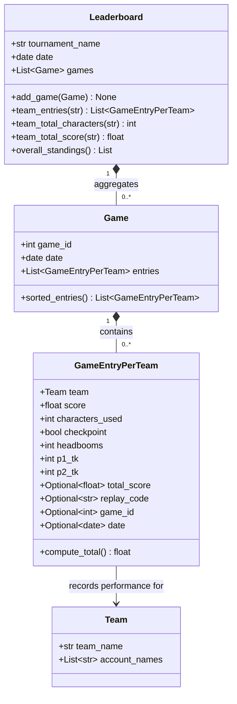
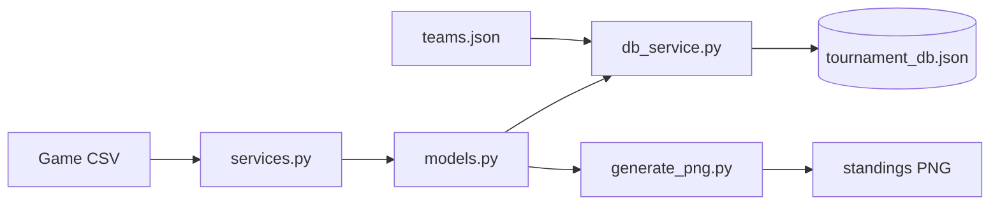

# Domain model structure

The domain model is defined in [`models.py`](./models.py). It represents a tournament
as a leaderboard containing games, with one result entry per team in each game.

## Relationships

- **`Team`** is the registered team and its player/account names.
- **`GameEntryPerTeam`** is the team's result for one game. It owns the
  per-game scoring and usage fields and references the team it belongs to.
- **`Game`** groups all team entries for one game identified by `game_id`.
- **`Leaderboard`** groups games for a tournament and calculates totals and
  standings across those games.

## Data flow around the model

`services.py` extracts raw CSV values, `db_service.py` persists and reconstructs
the dataclasses, and `generate_png.py` consumes `Leaderboard.overall_standings()`
to render the final standings image.
